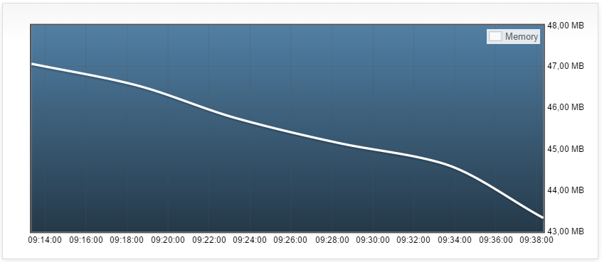
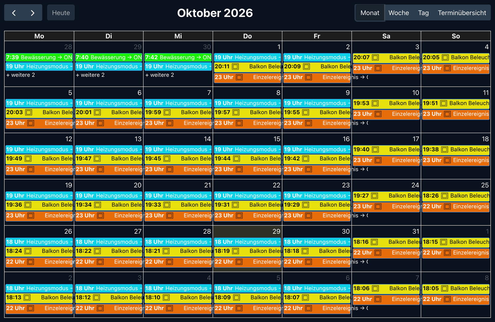

# ioBroker.fullcalendar

  [](https://www.npmjs.com/package/iobroker.fullcalendar)
[](https://www.npmjs.com/package/iobroker.fullcalendar)

[](https://nodei.co/npm/iobroker.fullcalendar/)

Schedules with [fullcalendar](https://fullcalendar.io).

## Plan the events (control your devices)
You must not use any external resources, the scheduling is processed only in ioBroker and will be not combined with any external services like "google calendar" or "iTunes".



The vis-2 widget in the month view with a dark theme: watering, heating mode and balcony light as events.



You can control your events with a calendar and can plan to control them periodically.

- **Duration** of "On/Off" and "Toggle" events can be given in seconds, minutes or hours. With a duration of 1 second, an event works like a push button.
- **Condition** ("Only if"): an event writes its value only if another state has the given value at that time (`==`, `!=`, `>`, `>=`, `<`, `<=`), e.g. the shutter goes down only if the terrace door is closed. If the condition is not met, the whole event is skipped (an "On/Off" event does not write the end value either), and a line is written to the log.
- **Calendars** can be switched off (button in the calendar list or "Active" in the calendar dialog): their events stay, but are not executed until the calendar is switched on again. This way you can prepare scenarios like "Vacation" and switch them by a script (`enableCalendar`, see below).

## Events simulation
You can record your behavior and can play it back later.
For example, you can create two recordings for workday and for weekend and play them back on according days.

Or you can record the whole week and can play it back in the next weeks while you are away.

How to use:
- Go to the simulation tab
- Create the new simulation by clicking on the "+" button and selecting the type of simulation: day or week
- Click the record button and wait 24 hours or 7 days till simulation stops to record events
- Now you can replay the simulation by clicking on the play button. Additionally, you can define the time when the simulation should be started.

## Agenda states
The adapter writes what is planned into states, e.g. to ask a chat or voice assistant about it or to show it in a visualization:

| State                          | Content                                                                         |
|--------------------------------|---------------------------------------------------------------------------------|
| `fullcalendar.0.events.list`        | all events (JSON): name, calendar, state, value, time or cron, next execution |
| `fullcalendar.0.events.today`       | executions today (JSON), also the ones already done                            |
| `fullcalendar.0.events.tomorrow`    | executions tomorrow (JSON)                                                     |
| `fullcalendar.0.events.next`        | the next execution (JSON, `null` = none)                                      |
| `fullcalendar.0.events.count`       | number of events                                                               |
| `fullcalendar.0.events.lastChanged` | time of the last change of an event                                            |

One execution looks like this (times are local times of the ioBroker host):
```json
{"id": "fullcalendar.0.event-…", "name": "Light living room", "calendar": "", "time": "2026-10-28T22:30:00", "ts": 1793223000000,
 "oid": "hm-rpc.0.ABC.1.STATE", "value": false, "recurring": false}
```
A "double" event has `endTime` and `endValue` too, `calendar` is `""` for the default calendar. Events of simulations are not part of the agenda.

## Script and adapter API (sendTo)
Other adapters and scripts can plan events, e.g. a voice assistant for "turn off the light in 2 hours":
```js
// in 2 hours (`in`: seconds, or "90s", "30m", "2h", "1h30m", "1d")
sendTo('fullcalendar.0', 'addEvent', { oid: 'hm-rpc.0.ABC.1.STATE', value: false, in: '2h' }, res => log(JSON.stringify(res)));
// at a time (local time, or a timestamp in ms), for 10 minutes, in the calendar "Garden"
sendTo('fullcalendar.0', 'addEvent', {
    oid: 'hm-rpc.0.PUMP.1.STATE', value: true, start: '2026-10-29T07:30', duration: '10m', calendar: 'Garden', name: 'Pump',
}, res => log(JSON.stringify(res))); // {id, name, type, start, ts} or {error}
// every year on June 15 at 08:00 (a birthday), the start may be in the past
sendTo('fullcalendar.0', 'addEvent', {
    oid: '0_userdata.0.birthday', value: 'Anna', start: '2020-06-15T08:00', recurring: 'yearly', name: 'Birthday Anna',
}, res => log(JSON.stringify(res))); // {id, name, type, start: next execution, ts, cron: "0 0 8 15 6 *"}
// delete all events with this name
sendTo('fullcalendar.0', 'deleteEvent', { name: 'Birthday Anna' }, res => log(JSON.stringify(res)));
```

| Command          | Message                                                                                    | Answer                                            |
|------------------|--------------------------------------------------------------------------------------------|---------------------------------------------------|
| `addEvent`       | see below                                                                                  | `{id, name, type, start, ts, cron?}` (`start`/`ts` = first execution) |
| `deleteEvent`    | `id`, `ids` (a list) and/or `name` (all events with exactly this name; optional `calendar`) | `{result: "ok", deleted: [id, …], notFound?: [id, …]}` |
| `getEvent`       | `id`                                                                                       | `{event: definition}`                             |
| `getEvents`      | optional `calendar`                                                                        | `{events: [definition, …]}`                       |
| `listEvents`     | optional `from`, `to` (default now … 7 days, or `days`), `calendar`, `max`                   | `{events: [execution, …]}`                        |
| `getCalendars`   | –                                                                                          | `{calendars: [{id, name, enabled}, …]}`           |
| `enableCalendar` | `calendar` (name or ID), `enabled` (`true`/`false`)                                        | `{id, enabled}`                                   |
| `getCommands`    | –                                                                                          | `{commands: [{command, params, answer}, …]}`      |

Parameters of `addEvent`:

| Parameter                  | Meaning                                                                                                    |
|----------------------------|------------------------------------------------------------------------------------------------------------|
| `oid`                      | state to write (must exist and be writable)                                                                |
| `value`                    | value to write                                                                                             |
| `start` or `in`            | `start`: local time (`"2026-10-29T07:30"`, `"07:30"` = today) or a timestamp in ms; `in`: delay (seconds, or `"90s"`, `"30m"`, `"2h"`, `"1h30m"`, `"1d"`) |
| `duration` / `durationSec` | after this time (same formats as `in`) the second value is written; then `type` is `"double"` by default |
| `type`                     | `"single"` (default), `"double"` (writes `endValue` after `duration`), `"toggle"` (switches back after `duration`) |
| `endValue`                 | value of `"double"`; for a boolean `value` the default is the opposite                                    |
| `recurring`                | `"daily"`, `"weekly"`, `"monthly"` or `"yearly"`: repeats at the time of day of `start` (also of a `start` in the past). The day comes from `start`, or from `weekdays` (list, `0` = Sunday or `"MO"`, `"TU"`…), `monthDays` (list, 1…31), `months` (list, 1…12) |
| `rrule`                    | instead of `recurring`: iCal rule, e.g. `"FREQ=YEARLY"`, `"FREQ=WEEKLY;BYDAY=MO,FR"`, `"FREQ=MONTHLY;BYMONTHDAY=1,15"`. Supported: `FREQ` (DAILY, WEEKLY, MONTHLY, YEARLY), `BYDAY` (plain weekdays), `BYMONTHDAY`, `BYMONTH`. Not supported: `INTERVAL` > 1, `COUNT`, `UNTIL`, `BYDAY=2MO` |
| `name`                     | name of the event, default: name of the state                                                              |
| `calendar`                 | name or ID of the calendar, default: the default calendar                                                  |
| `color`                    | color in the calendar                                                                                      |

Errors come back as `{error}`, an unknown command answers with the list of the commands. A new event appears in the calendar like one created by hand and can be edited there. Recurring events run at whole minutes.

## Todo
- Week and day must scroll to the current time

<!--
	Placeholder for the next version (at the beginning of the line):
	### **WORK IN PROGRESS**
-->
## Changelog
### **WORK IN PROGRESS**
* (bluefox) Fixed: `addEvent` ignored `type` and `durationSec`, a "double" event was saved as "single"
* (bluefox) Added recurring events to `addEvent`: `recurring` (daily, weekly, monthly, yearly) or an iCal `rrule`
* (bluefox) `deleteEvent` deletes a list of events (`ids`) or all events with a name (`name`)
* (bluefox) Added the messages `getEvent` and `getCommands`, an unknown command answers with the list of the commands
* (bluefox) Documented all messages and parameters in the README

### 3.2.0 (2026-10-29)
* (bluefox) Fixed white screen when adding an event in the vis-2 widget (#444)
* (bluefox) Fixed: the recording of a simulation stopped immediately after the start (#234)
* (bluefox) Fixed: the simulation recorded repeated status updates without a change of the value, e.g. of Tasmota or Sonoff devices (#285, #235)
* (bluefox) Fixed: the subscriptions of a stopped recording were not removed
* (bluefox) Added: the duration of "On/Off" and "Toggle" events can be given in seconds, minutes or hours, e.g. for a push button (#354)
* (bluefox) Added: conditions for events, e.g. do not close the shutter if the door is open (#257)
* (bluefox) Added: calendars can be switched off and on, also with the message `enableCalendar` (#236)

### 3.1.1 (2026-10-29)
* (GermanBluefox) Fixed display of recurring events after DST change (#448)

### 3.1.0 (2026-10-28)
* (bluefox) Added agenda states `events.list/today/tomorrow/next/count/lastChanged`
* (bluefox) Added the messages `addEvent`, `deleteEvent`, `listEvents`, `getEvents` and `getCalendars`, e.g. for voice assistants
* (bluefox) A one-shot event in the past is no longer marked as disabled in memory

### 3.0.5 (2026-10-19)
* (ioBroker-Bot) Adapter requires js-controller >= 6.0.11 now.
* (bluefox) Migrated GUI to vite
* (bluefox) Updated packages

### 3.0.1 (2026-08-05)
* (bluefox) Migrated GUI to React19

[Older changelogs can be found there](CHANGELOG_OLD.md)

## License
The MIT License (MIT)

Copyright (c) 2017-2026 Bluefox <dogafox@gmail.com>

Permission is hereby granted, free of charge, to any person obtaining a copy
of this software and associated documentation files (the "Software"), to deal
in the Software without restriction, including without limitation the rights
to use, copy, modify, merge, publish, distribute, sublicense, and/or sell
copies of the Software, and to permit persons to whom the Software is
furnished to do so, subject to the following conditions:

The above copyright notice and this permission notice shall be included in
all copies or substantial portions of the Software.

THE SOFTWARE IS PROVIDED "AS IS", WITHOUT WARRANTY OF ANY KIND, EXPRESS OR
IMPLIED, INCLUDING BUT NOT LIMITED TO THE WARRANTIES OF MERCHANTABILITY,
FITNESS FOR A PARTICULAR PURPOSE AND NONINFRINGEMENT. IN NO EVENT SHALL THE
AUTHORS OR COPYRIGHT HOLDERS BE LIABLE FOR ANY CLAIM, DAMAGES OR OTHER
LIABILITY, WHETHER IN AN ACTION OF CONTRACT, TORT OR OTHERWISE, ARISING FROM,
OUT OF OR IN CONNECTION WITH THE SOFTWARE OR THE USE OR OTHER DEALINGS IN
THE SOFTWARE.
